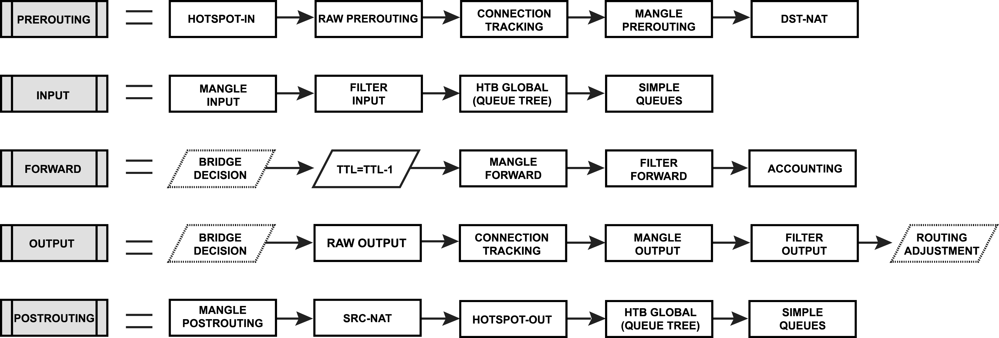

# mikrotik-routeros-hands-on

Practical exercises and hands-on labs for MikroTik RouterOS, networking fundamentals, routing, and network configuration.


## Resources

- [pbxshop](https://pbxshop.co/free-courses/free-mikrotik-course/)
- [MTCRE](https://www.youtube.com/watch?v=4BOYqtV4MCY&list=PLJ7SGFemsLl1QUNkgAbGj9ldlWRrr8zMj)
- [VLAN](https://www.youtube.com/watch?v=NQJs2-LqbCY)
- [GRE](https://www.youtube.com/watch?v=4DUjL7oEopk)
- [WireGuardVPN](https://www.youtube.com/watch?v=Y-6BpfEBQBo)
- [IRAN IP LIST](https://dl.pbxshop.co/upload/software/IP-Ranges-By-IR.zip)

## MikroTik Certified 

- MTCNA
- MTCRE
- MTCTCE

## First Steps

1. System -> Reset Factory
2. Account Creation: System -> Users
3. IP -> Services (Disable all unnecessary services)


## Take IP

- IP -> Address List
  ```yaml
  - address: "192.168.0.1/24"
    network: "192.168.0.0"
    interface: "ether1"
  ```

## Bridge

We can make a bridge between multiple ports, after than they work as a `layer2 switch`.

## Internet into router

1. VPN Client (pppoe)

```
ISP ---- [Bridged     Modem] ------- pppoe Client ------- Router
```

2. DHCP Client

```
ISP ---- [Non Bridged Modem] ------- DHCP Client -------- Router
```

3. IP Static

## Routing

**Default Route:**

Destination is not specefic, generally 0.0.0.0/0

**Static Route:**

**Connected Route:**

If you add a new ip in `Address List`, a related `Connected Route` is created by mikrotik.


## NAT (Network Address Translation)

1. SRC NAT
   1. Static NAT  (Lan into Wan)
   2. Dynamic NAT (multiple Lans into multiple Wans)
   3. PAT         (Port Management)
2. DST NAT

Chain `srcnat` Actions:
   - masqureate: automatically converte a local ip into public (route) ip
   - src-name:   can define which pubic IP should be used

## Security

1. Disable unused `IP Service List`
2. Change service's port which you want to be active in `IP Service List`
3. `Filter Rules` (IP -> Firewall -> Filter Rules)
4. In `L2TP` disable both `chap` and `pap` type
5. In `IPsec Proposal` select `sha256` and `aes-256 cbc`

## Packet Flow

